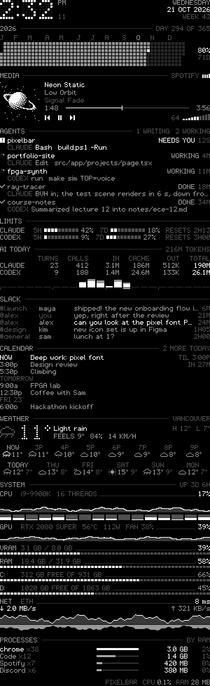
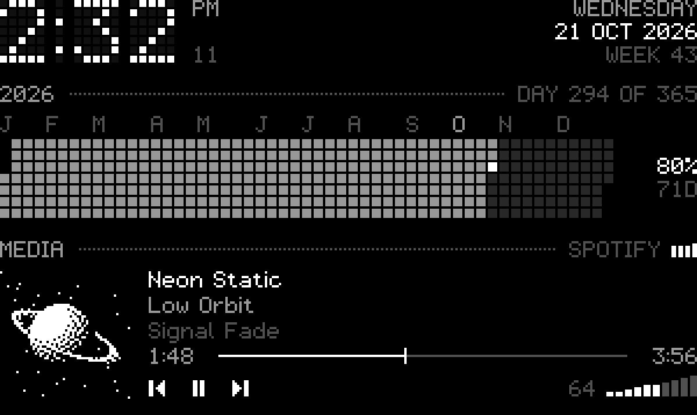
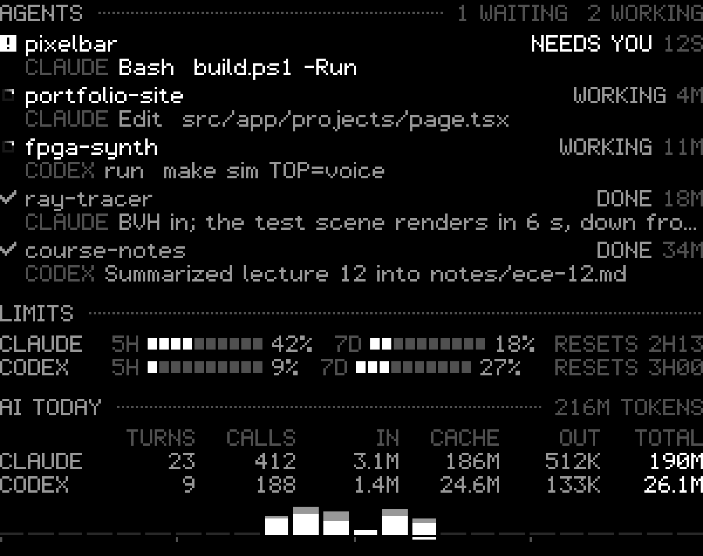
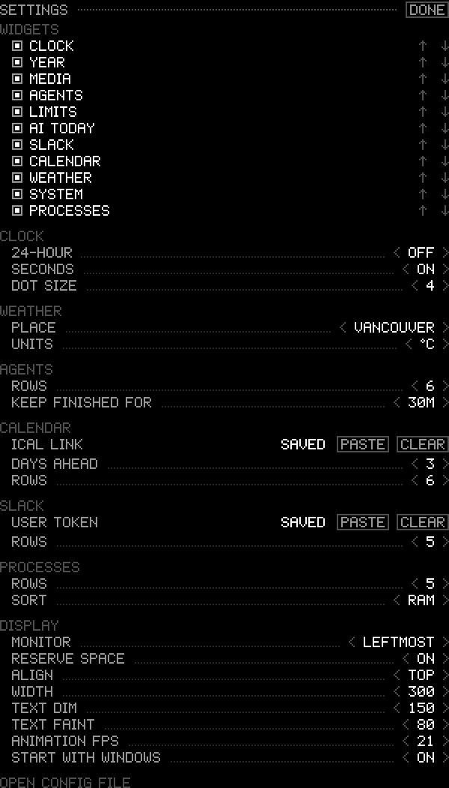

# pixelbar

A Rainmeter-style status column for the edge of a Windows desktop: white 1-bit pixel art
on a black wallpaper. One native C++ window (Win32 and C++/WinRT, no framework, no
runtime to install) draws eleven widgets, from the clock and the music to what every
Claude Code and Codex session is doing, for a fraction of a percent of the machine and
about 30 MB.

<p align="center">
  
  &nbsp;&nbsp;&nbsp;
  
</p>
<p align="center"><sub>Launch, left, and the settled column. Every image here uses <code>--demo</code>'s made-up data and is rendered by <a href="docs/make_images.py"><code>docs/make_images.py</code></a>.</sub></p>

## Widgets

In the default order; turn them on, off and reorder them in **Settings**.

| Widget | Shows | Source |
|---|---|---|
| Clock | dot-matrix time, seconds, day, date, ISO week | system clock |
| Year | every day of the year as a cell, a column per week (Monday on top): days gone filled, today lit, the rest waiting; month initials, day number, percent gone, days left | system clock |
| Media | 56x56 Atkinson-dithered cover, title marquee, artist, album, progress, prev / play / next, volume wedge, level bars on the real output peak | Windows media session (Spotify, browsers, most players), Core Audio |
| Agents | each Claude Code / Codex session: working (and the tool it's on), needs you, asks, done (with its recap), stopped, quiet. Click opens the session | the apps' own logs, below |
| Limits | Claude 5-hour and 7-day usage, Codex window usage and time to reset | Claude desktop's usage samples, Codex rate-limit events |
| AI today | per app since midnight: turns you typed, model requests, and tokens as new input, cache reads, output and total; output by hour (Claude under Codex) | every Claude Code transcript (subagents included) and Codex rollout written today |
| Calendar | running and next events, grouped by day | your calendar's private iCal link |
| Slack | the newest messages of the last two days, yours included ("you"), with the channel or DM partner. DMs to you are brighter. Click opens the message | Slack search API with your user token |
| Weather | now (dot-matrix), next 8 hours, next 6 days | open-meteo.com, no key |
| System | CPU + per-core, GPU load / temp / watts / fan, VRAM, RAM, each fixed disk, network rate + latency | GetSystemTimes, NVML (NVIDIA), GlobalMemoryStatusEx, GetIfTable2, ICMP |
| Processes | heaviest apps grouped by name (Chrome's dozens of processes are one row), by RAM or CPU | NtQuerySystemInformation |

<p align="center">
  
  <br><br>
  
</p>

## Build and run

Needs VS Build Tools with the C++ workload (MSVC 14.50) and the Windows SDK (it uses the
SDK's ICU and WinHTTP); nothing is downloaded.

```powershell
.\build.ps1 -Run      # build into bin\ and (re)start it
```

`meter start`, `meter stop`, `meter restart` and `meter status` run it from any cmd or
PowerShell prompt once `meter.cmd` is reachable: put a one-line `meter.cmd` containing
`@call "<this folder>\meter.cmd" %*` in any folder on your PATH. Start goes through
Explorer, as `-Run` does, so the column outlives the prompt and any app the prompt runs
inside (a copy started from an agent shell lives inside the Claude app and closes when
the app restarts). Opening `bin\pixelbar.exe` also works; a second launch replaces the
running copy, and **START WITH WINDOWS** in Settings starts it at sign-in.

| Flag | |
|---|---|
| `--quit` | close the running copy |
| `--autostart-on`, `--autostart-off` | add or remove the HKCU Run entry |
| `--dump file.bmp [--settings]` | render one frame to a file without touching the desktop, which is how layout changes get checked |
| `--record <dir>` | save every frame of the first three seconds (8-bit BMPs plus `frames.csv`), which is how motion gets checked |
| `--demo` | fill every widget with made-up data, staged over the first second like real data; touches no logs, network or devices |

`PIXELBAR_DEBUG=1` logs fetch failures to `%TEMP%\pixelbar-debug.log`.

## Controls



Hover the column and **SETTINGS** appears under the last widget (also on the right-click
menu). The right side of that row always shows what pixelbar itself costs, measured the
way the process list and Task Manager measure everything else: CPU as a share of the
whole machine over the last second, and private working set.

Media: click the buttons; click or drag the volume wedge; click the number to mute;
scroll over the media block for volume; click the progress bar to seek (players that
allow it). **BY RAM / BY CPU** in the processes header flips the sort.

The column reserves its strip the way the taskbar reserves its edge: it registers as an
app bar on the monitor's left edge (`marginX * 2 + width` px), so maximized and snapped
windows stop at its right side. Quitting hands the strip back. Turn it off with
**RESERVE SPACE** in Settings to float it on the desktop instead. Either way it sits
directly above the desktop in the z-order: under any window dragged over it, over the
wallpaper.

<br clear="right">

## Calendar and Slack setup

Both secrets live in Windows Credential Manager (`pixelbar:ical`, `pixelbar:slack`), never
in `config.json`. Copy the value, then click **PASTE** in Settings; pixelbar clears the
clipboard after saving it.

- **Calendar**: Google Calendar > Settings > your calendar > Integrate calendar >
  *Secret address in iCal format*. Recurring events (daily, weekly with days, monthly by
  day or nth weekday, yearly), exceptions and moved instances are expanded locally;
  time zones go through ICU.
- **Slack**: api.slack.com/apps > Create New App > From scratch > OAuth & Permissions >
  *User Token Scopes*: `search:read` and `users:read` > Install to Workspace > copy the
  *User OAuth Token* (`xoxp-...`).

## Where agent status comes from

| Agent | Source |
|---|---|
| Claude Code | Tail of `~/.claude/projects/<project>/<session>.jsonl`. Titles and the deep link (`claude://code/continue?session=…`) come from `%APPDATA%\Claude\claude-code-sessions\**\local_*.json`; plan usage from `%APPDATA%\Claude\plan-usage-history.json`. |
| Claude permission prompts | Not in the transcript, so a `PermissionRequest` hook in `~/.claude/settings.json` copies the request to `~/.claude/pixelbar/perm-<session>.json`. A prompt counts as pending while that file is newer than the transcript. |
| Codex (ChatGPT desktop app) | Tail of `~/.codex/sessions/YYYY/MM/DD/rollout-*.jsonl` (`task_started` / `task_complete` / `turn_aborted`, and `rate_limits` on `token_count`), names from `~/.codex/session_index.jsonl`, link `codex://threads/<id>`. |

The hook, as an entry under `PermissionRequest` in `~/.claude/settings.json`:

```json
{ "type": "command", "async": true, "timeout": 10,
  "command": "mkdir -p \"$HOME/.claude/pixelbar\" && cat > \"$HOME/.claude/pixelbar/perm-${CLAUDE_CODE_SESSION_ID:-$$}.json\"" }
```

Claude's usage numbers are only as fresh as the desktop app's last sample, so the row
says how old they are once that passes 20 minutes.

**AI today** reads the same files from the start of the day: transcripts run to hundreds
of MB, so a binary search on timestamps finds where today begins, then each file is
followed by byte offset. A Claude message's usage repeats on every line the message is
split across, so requests count once per message id; Codex writes one
`token_usage_record` per request, counted once per response id. A turn is a message you
typed; subagent briefs, compaction summaries and the `<tagged>` messages the app injects
don't count. Tokens split three ways: **IN** is input not read from the cache (prompts,
tool results, and Claude's cache writes), **CACHE** is context re-read from the prompt
cache, which is most of the total because every request re-reads the conversation so
far, and **OUT** is what the models wrote.

## Config

`bin\config.json` is written by Settings and reloads when edited by hand.

| Key | Default | |
|---|---|---|
| `monitor` | `"leftmost"` | `leftmost`, `rightmost`, `primary`, or `1`..`n` counted left to right |
| `scale` | `0` | physical px per pixel; `0` = from the monitor's DPI |
| `width`, `marginX`, `marginY`, `valign` | `300`, `24`, `28`, `"top"` | |
| `reserve` | `true` | keep windows out of the column's strip |
| `sections` | all eleven | order and selection |
| `clock` | `{ "24h": true, "seconds": true, "dotPitch": 4 }` | |
| `agents` | `{ "max": 6, "doneMinutes": 45, "staleMinutes": 15, ... }` | |
| `weather` | `{ "place": "Vancouver", "lat": 49.2827, "lon": -123.1207, "fahrenheit": false }` | |
| `calendar`, `slack`, `processes` | `{ "days": 3, "max": 6 }`, `{ "max": 5 }`, `{ "max": 5, "sort": "ram" }` | |
| `pingHost`, `gpu`, `fps` | `"1.1.1.1"`, `true`, `15` | |
| `ink` | `{ "dim": 150, "faint": 56, "background": 1 }` | alpha of white; the backing alpha of 1 keeps clicks between pixels on the column |

## Design notes

- Text is one hand-drawn 5x7 font (proportional, real lowercase and descenders) drawn
  1:1, 7 px caps on a 10 px line. A first pass doubled its resolution by tracing strokes
  at 2x; it read as thin vector lines and lost the pixel feel, so it went back to native.
- The two large elements, the clock and the current temperature, are dot-matrix
  renderings of the same glyphs (3x3 dots on a 4 px grid, unlit dots faint), so big
  numbers stay pixel art without 4 px blocks.
- Dense on purpose: 10 px between widgets, 10 px lines, detail in a fixed column.
- When the widgets outgrow the monitor, the lists nearest the bottom (processes, Slack,
  calendar) give up rows first; a widget that still won't fit is left out whole rather
  than cut through.
- Motion: widgets are stacked by displayed heights that follow the real ones on a
  critically damped spring (about 200 ms, no overshoot), so a widget filling in pushes the
  rest aside instead of making them jump. New content dissolves in through an 8x8 ordered
  dither: on launch (and to or from Settings) the widgets cascade in from the top, rising
  5 px; a widget whose content changes kind (LOADING to data, a new track) dithers its
  body in again, while one that only moved never re-fades. While anything moves, frames
  are paced to the monitor's vertical blank; otherwise the column redraws only on change.
  Windows' *Animation effects* setting turns it off.
- Text the font can't draw (Hebrew, CJK) falls back to GDI with anti-aliasing off, on
  the same grid.

## Layout of the code

`canvas.cpp` font, text and dot-matrix rendering · `ui.cpp` every widget and the
settings panel · `motion.cpp` stacking, springs and dither fades · `media.cpp` SMTC ·
`audio.cpp` Core Audio · `sysinfo.cpp` counters, NVML, processes · `agents.cpp` Claude /
Codex log readers and limits · `today.cpp` today's usage from the same logs ·
`online.cpp` WinHTTP, Credential Manager, weather, iCal parser, Slack · `demo.cpp` the
`--demo` data · `config.cpp` · `main.cpp` the window, frame pump and recorder.

## Known gaps

- Win+D handling is written but has not been exercised.
- AI today counts Claude Code only: chats in the Claude desktop app or on claude.ai
  leave no local log.
- Codex approval prompts are not in its rollout files, so a Codex session waiting on
  one shows as working.
- GPU detail needs an NVIDIA driver; other GPUs fall back to the 3D-engine load only.
- No automated tests; verified by rendered frames, frame-by-frame recordings of the
  motion, an independent recount of the token numbers, and the live column.
